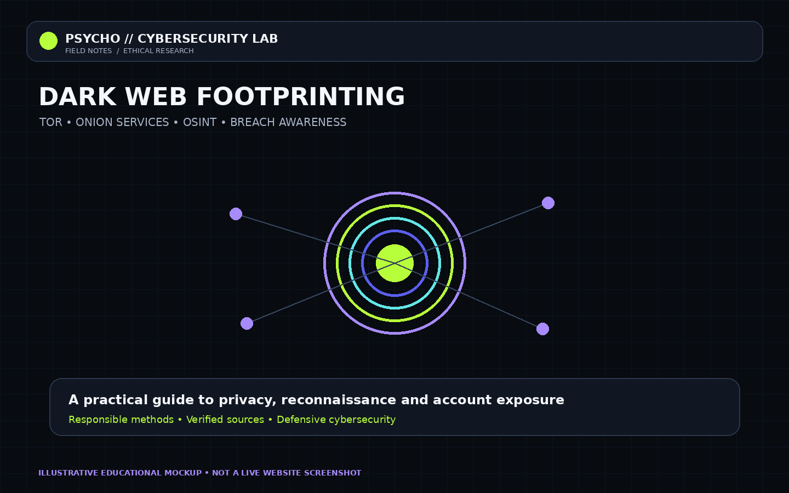
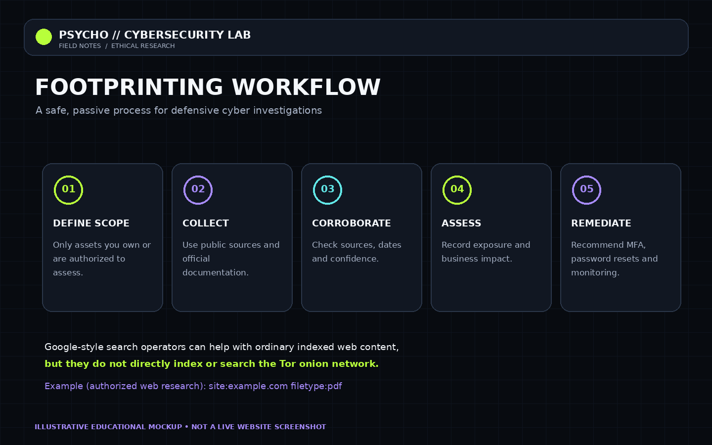
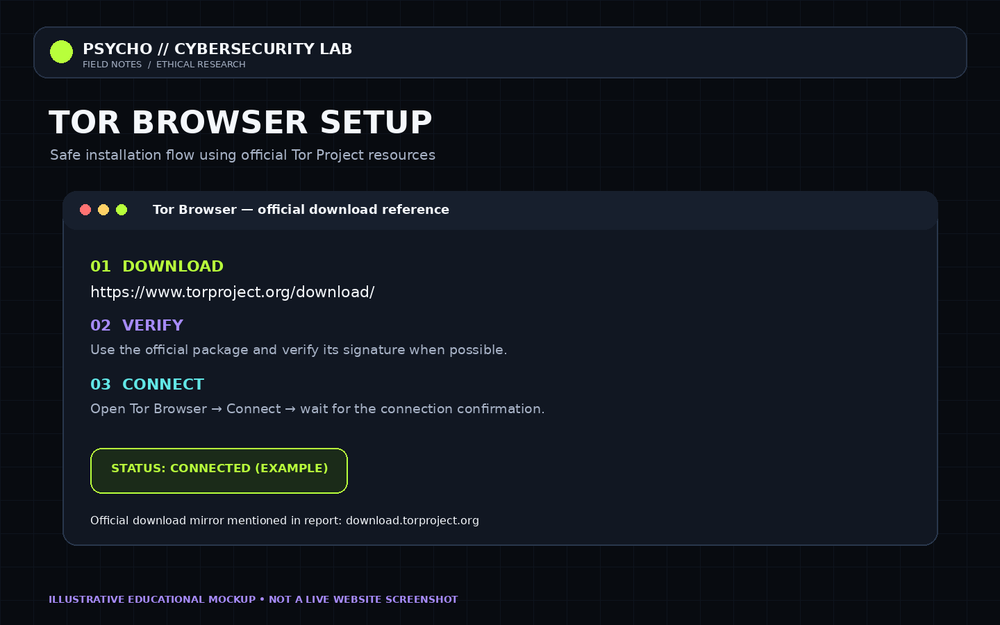
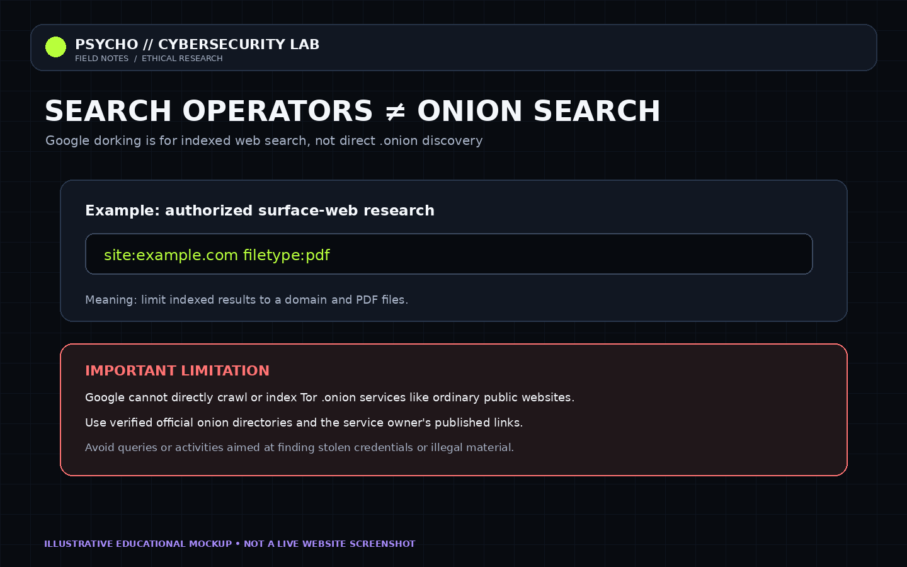
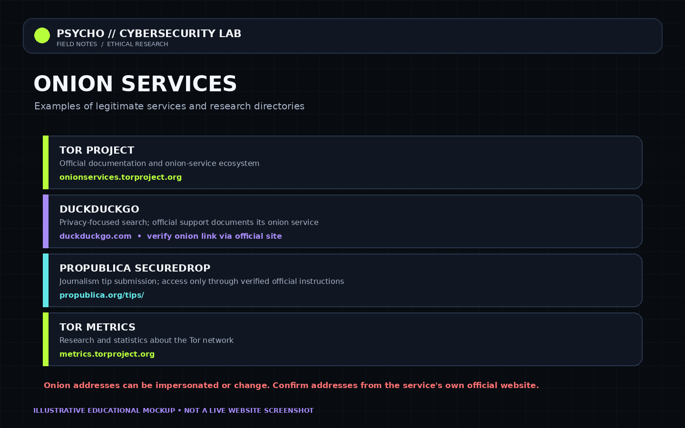
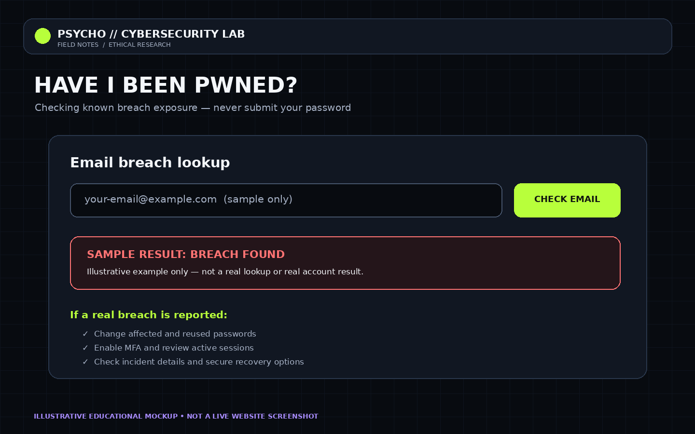

# 🌐 Dark Web Footprinting, Tor Installation & Breach Awareness

<p align="center">
  
</p>

<p align="center">
  
  
  
</p>

> **Purpose:** Educational and defensive cybersecurity research. The images in `screenshots/` are original illustrative mockups created for this report; they are **not screenshots of live websites or actual test results**.

## Contents
- [1. What is the dark web?](#1-what-is-the-dark-web)
- [2. What is dark web footprinting?](#2-what-is-dark-web-footprinting)
- [3. Tor installation](#3-tor-installation)
- [4. Search operators / Google dorking](#4-search-operators--google-dorking)
- [5. Legitimate onion-service examples](#5-legitimate-onion-service-examples)
- [6. Have I Been Pwned](#6-have-i-been-pwned)
- [7. Use in cybersecurity](#7-use-in-cybersecurity)
- [8. Safe practical workflow](#8-safe-practical-workflow)
- [9. Screenshots](#9-screenshots)
- [10. References](#10-references)

## 1. What is the dark web?

The **dark web** is a part of the internet accessed through privacy networks or specialized software. One widely used system is **Tor**. Onion services use addresses ending in `.onion` and are reachable through the Tor network.

The dark web is not the same as the deep web. The deep web includes ordinary content that search engines do not index, such as private email inboxes, account pages and subscription databases. The dark web is a smaller part that requires specialized access.

### What is it used for?
- **Privacy:** reducing direct exposure of a user's IP address to websites.
- **Journalism and source protection:** enabling safer communication with sources.
- **Censorship resistance:** helping users reach information where access is restricted.
- **Research:** studying privacy technology, threat trends and publicly reported cyber incidents.
- **Misuse also exists:** scams, malware and illegal marketplaces can be present, so caution and lawful boundaries matter.

Tor does **not** guarantee complete anonymity. User logins, unsafe downloads, browser fingerprinting and voluntarily shared personal details can still expose identity.


## 2. What is dark web footprinting?

**Footprinting** is the reconnaissance stage of a security assessment: collecting information about a target's digital presence. Dark web footprinting, when conducted lawfully, can include checking reliable public reporting and authorized sources for references to a company's domain, brand, exposed accounts or reported data breaches.

### Why is it useful?
1. **Exposure awareness:** learn whether an email or organization is mentioned in a known breach.
2. **Risk assessment:** understand the possible impact of exposed contact details or credentials.
3. **Incident response:** help prioritize password resets, MFA and monitoring.
4. **Threat intelligence:** correlate public reports with known incidents.
5. **Security reporting:** document evidence, source reliability and remediation.

A responsible workflow is: **define scope → collect public information → corroborate → assess risk → recommend remediation**.



## 3. Tor installation

### Official download
- Tor Project: https://www.torproject.org/download/
- Download host requested for this project: https://download.torproject.org/
- Installation instructions: https://support.torproject.org/tor-browser/getting-started/installing/

### Windows
1. Visit the official Tor Project download page.
2. Download the Windows Tor Browser package.
3. Verify the download signature when possible.
4. Run the installer and follow the prompts.
5. Open Tor Browser and select **Connect**.
6. Wait for the connection to complete.

### Android
1. Open the official Tor Project download page or official distribution listing.
2. Install Tor Browser from an official source.
3. Open the browser and tap **Connect**.

### Linux
Download the Linux package from the official page, verify it where possible, extract it, and follow the official launch instructions for your distribution.

### How Tor routing works
For regular websites, Tor commonly routes traffic through a guard relay, a middle relay and an exit relay. Onion services use a different connection design and do not require a conventional exit relay to reach the onion service.



**Safety:** keep Tor updated, avoid untrusted extensions and files, and never assume a `.onion` address is trustworthy just because it uses Tor.

## 4. Search operators / Google dorking

Google dorking means using advanced search operators to narrow search results. It is useful for authorized **surface-web** research, such as finding public documents on a domain you own or have permission to assess.

Example:
```text
site:example.com filetype:pdf
```
This asks an ordinary search engine to show indexed PDF results from `example.com`.

Other common operators for legitimate research:
- `site:example.com` — limit results to a domain.
- `filetype:pdf` — limit results by file type.
- `"exact phrase"` — search for an exact phrase.

### Can `site:` search the dark web?
**No—not directly.** Google does not directly crawl and index `.onion` services like ordinary public websites. A query such as `site:example.onion` will not function as a reliable onion-site discovery method. For legitimate onion services, use links published by the service's official clearnet website or the Tor Project's onion-service documentation.

Do not use search operators to seek stolen credentials, private personal data, exposed secrets or unauthorized access.



## 5. Legitimate onion-service examples

Use these as **starting points for official documentation and legitimate privacy research**. Confirm current onion addresses from the organization's own official website before using them; addresses can change and impostors exist.

| Service | Purpose | Official starting point |
|---|---|---|
| Tor Onion Services Ecosystem | Documentation and discovery of onion-service projects | https://onionservices.torproject.org/ |
| DuckDuckGo | Privacy-oriented search; its official support explains its onion service | https://duckduckgo.com/ |
| ProPublica SecureDrop | Secure tip submission for journalism, following the newsroom's instructions | https://www.propublica.org/tips/ |
| Tor Metrics | Public statistics and research about the Tor network | https://metrics.torproject.org/ |

An onion service is not automatically safe or legitimate. Do not rely on random “dark web link lists”; verify each address through a trusted official source.



## 6. Have I Been Pwned

**Have I Been Pwned (HIBP)** is a service that lets users check whether an email address appears in known data-breach records included in its database.

Website: https://haveibeenpwned.com/

### How to use it
1. Open the official website.
2. Enter an email address you own or are authorized to check.
3. Review whether known breach records are listed.
4. Read the breach details and exposed data categories.
5. If relevant, change affected and reused passwords, enable MFA, review active sessions and secure recovery methods.

### What do results mean?
- **No known breach found:** no matching record was found in the data covered by that search. It does not prove the account has never been compromised.
- **Breach found:** the address appears in one or more known breach records. The data exposed depends on the incident.

Never enter your password into an email-breach search form. Avoid publishing your real email address or sensitive breach details in a public report.



## 7. Use in cybersecurity

| Cybersecurity area | How this topic helps |
|---|---|
| OSINT and reconnaissance | Organize lawful, public-source research before an assessment. |
| Threat intelligence | Understand public reporting about incidents and exposed data. |
| Incident response | Prioritize credential changes, session revocation and MFA. |
| Security awareness | Teach users about breach risks and password reuse. |
| Privacy engineering | Understand Tor, onion services and privacy limitations. |
| Risk management | Record findings, confidence and recommended controls. |

HIBP is a breach-awareness resource, **not a live search engine for the entire dark web**. Tor is a privacy network, **not a guarantee of anonymity**.

## 8. Safe practical workflow

### Activity A — Tor setup
- Download from the official Tor Project.
- Install and connect.
- Record the operating system and whether connection succeeded.
- Do not include private IP addresses or personal browsing history in the report.

### Activity B — HIBP check
- Use an email address you control.
- Record only a generalized outcome (for example, “breach record found” or “no known record found”).
- Redact the email address and other personal details from any screenshot.

### Activity C — Passive footprinting
- Select a domain you own or are authorized to assess.
- Use public search operators for ordinary indexed content.
- Verify findings against reliable sources.
- Document evidence, confidence and remediation without collecting secrets or stolen data.

## 9. Screenshots

The images below are original **educational mockups**, not real browser captures. Replace or supplement them with your own screenshots if your assignment requires evidence of actual installation or testing.

### Cover


### Tor installation


### Footprinting process


### Legitimate onion-service resources


### HIBP demo


### Search operators


## 10. References

1. Tor Project — https://www.torproject.org/
2. Tor Browser downloads — https://www.torproject.org/download/
3. Tor Browser installation guide — https://support.torproject.org/tor-browser/getting-started/installing/
4. Tor onion services explanation — https://support.torproject.org/about-tor/onion-services/what-is-a-dot-onion/
5. Onion Services Ecosystem — https://onionservices.torproject.org/
6. ProPublica SecureDrop instructions — https://www.propublica.org/tips/
7. Tor Metrics — https://metrics.torproject.org/
8. Have I Been Pwned — https://haveibeenpwned.com/

## Conclusion

Dark web footprinting can support defensive cybersecurity by helping researchers understand privacy technology, organize public information and respond to reported data exposure. Tor can improve privacy, while HIBP can help identify known breach exposure. Neither tool guarantees complete security. Ethical scope, source verification, strong unique passwords, MFA and careful handling of personal information remain essential.

**Disclaimer:** This report is for educational and defensive cybersecurity purposes. Conduct research only within the law, respect service terms, and obtain authorization before assessing systems or organizations.
